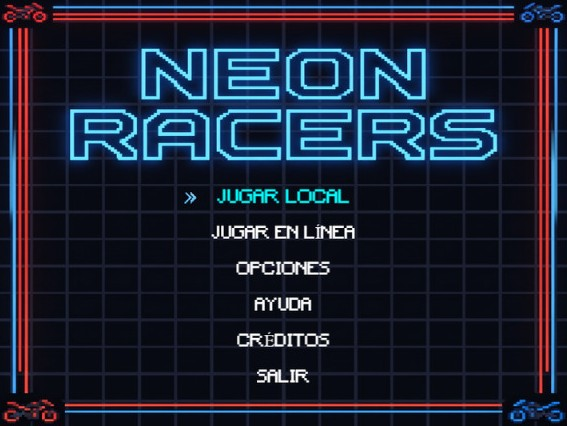
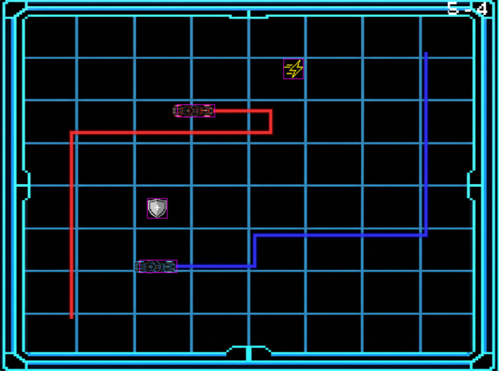
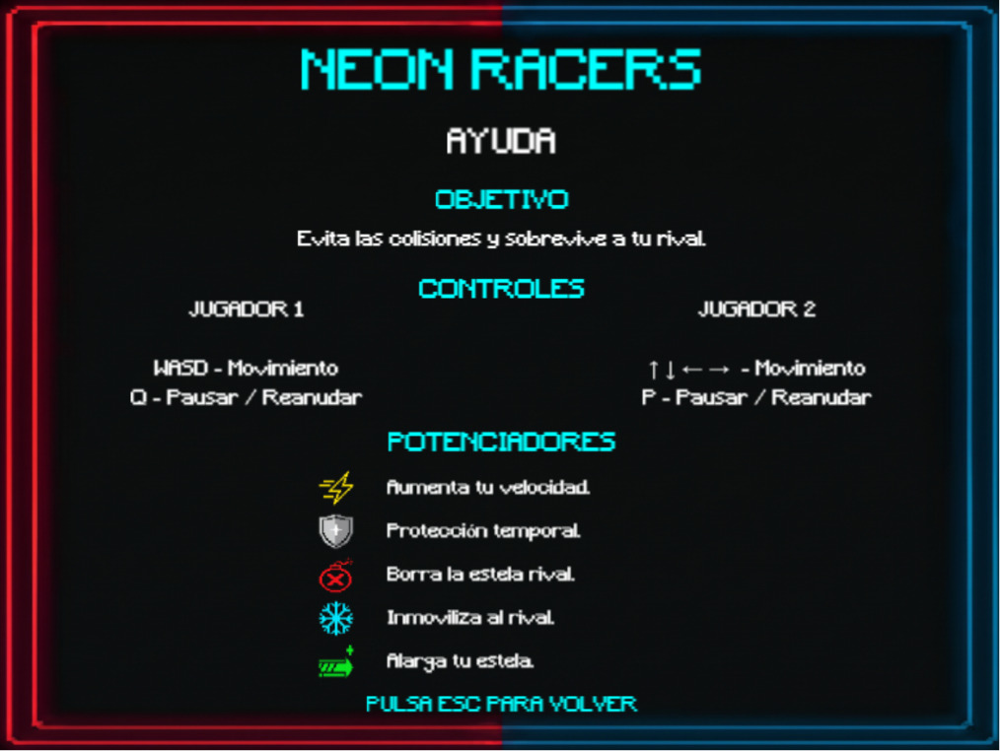
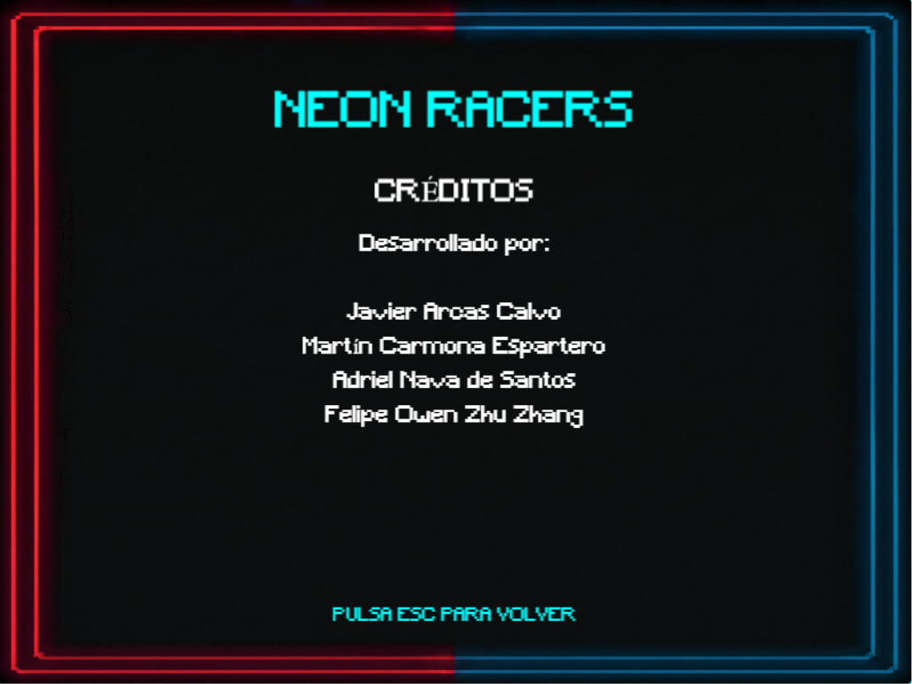
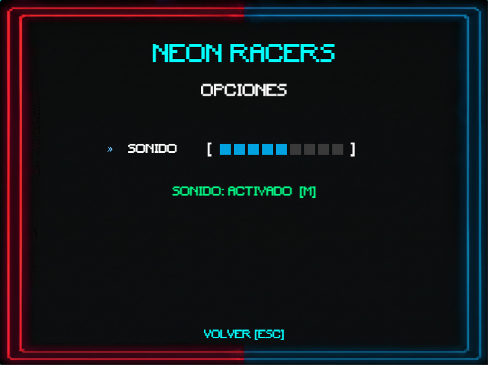
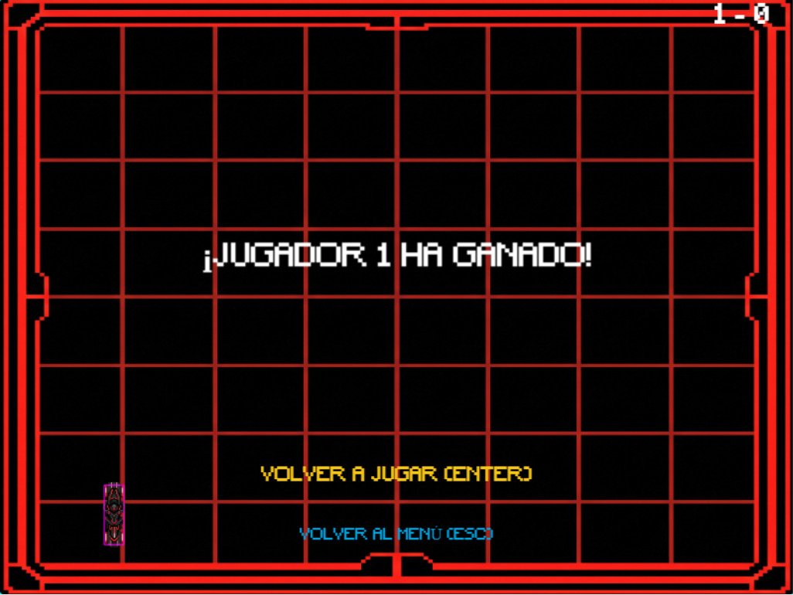
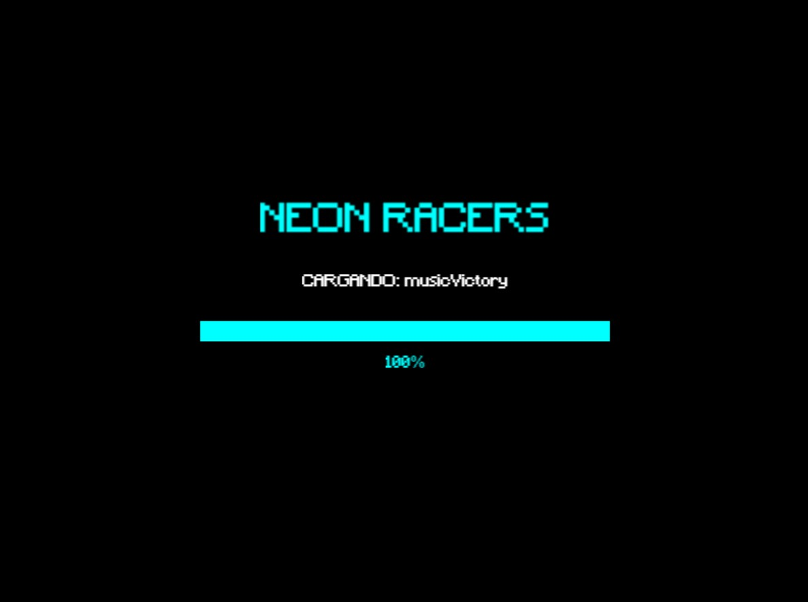
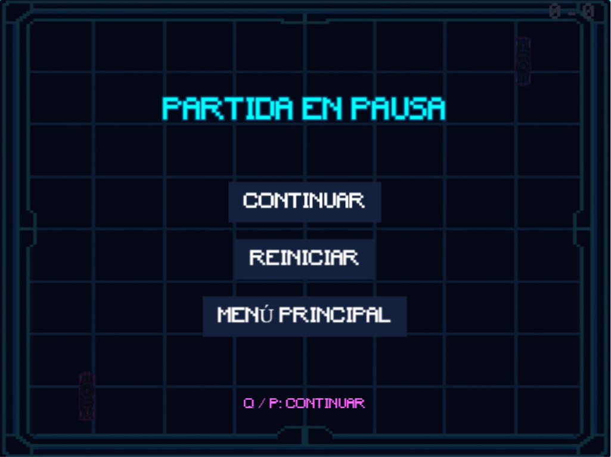
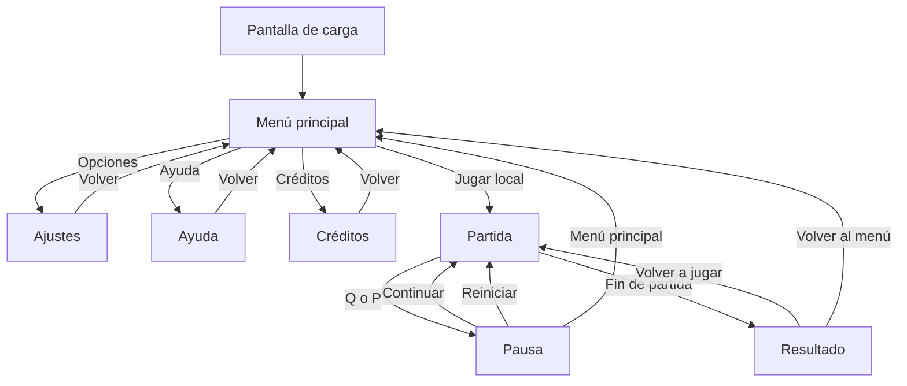

# Game Design Document (GDD)

## Índice

1. [Introducción](#1-introducción)
2. [Especificaciones básicas](#2-especificaciones-básicas)
3. [Jugabilidad](#3-jugabilidad)
4. [Narrativa](#4-narrativa)
5. [Imagen y diseño visual](#5-imagen-y-diseño-visual)
6. [Sonido](#6-sonido)
7. [Interfaz y diagrama de flujo](#7-interfaz-y-diagrama-de-flujo)
8. [Comunicación y marketing](#8-comunicación-y-marketing)
9. [Referencias](#9-referencias)

---

## 1\. Introducción

### 1.1. Concepto del juego

Neon Racers es un juego de PVP para dos jugadores en el que los jugadores tienen que hacer que el otro se choque con su estela para poder ganar. La idea principal es recrear el famoso juego de Tron y añadirle unos power ups que nos diferencien del real.

### 1.2. Propuesta de valor

¿Qué hace diferente a nuestro juego? Nuestro juego se diferencia de otros por la inclusión de poderes o “power-ups” con distintos efectos.

* Característica diferencial 1: Power-Ups de velocidad.  
* Característica diferencial 2: Power-Ups de inmortalidad.  
* Característica diferencial 3: Power-Ups de eliminar trazas.  
* Característica diferencial 4: Power-Ups de congelar al otro jugador.
* Característica diferencial 5: Power-Ups de traza aumentada.

   
Figura 1. Imagen promocional del juego.

## 2\. Especificaciones básicas

| Aspecto | Neon Racers |
| :---- | :---- |
| Título | Neon Racers |
| Género | Acción |
| Número de jugadores | 2 (modo local en tiempo real en la fase 2; modo en red previsto para fases posteriores) |
| Público objetivo | Todos los públicos |
| Clasificación PEGI | PEGI \+7 (violencia leve) |
| Plataforma | Navegador web (PC), desarrollado con Phaser 3 |
| Duración de una partida | Variable, hasta que se cumple una condición de fin de partida |
| Representación | 2D |
| Licencia | Apache 2.0 |

> [!NOTE]
> En la fase 2, el juego funciona exclusivamente en modo multijugador local. Aunque el menú principal incluye la opción «JUGAR EN LÍNEA», esta todavía no dispone de comunicación en red y actualmente inicia una partida local. La comunicación cliente-servidor mediante API REST se implementará en la fase 3, mientras que la comunicación en tiempo real mediante WebSockets se desarrollará en la fase 4.

---

## 3\. Jugabilidad

### 3.1. Objetivo del juego

El objetivo de cada jugador es sobrevivir al rival utilizando la estela de su moto y los power-ups del escenario. Un jugador pierde al colisionar con una estela, propia o rival, o con los límites del escenario. Si ambos jugadores colisionan entre sí, se produce un empate. No existe un límite de tiempo fijo para la partida.

### 3.2. Controles

| Acción | Jugador 1 | Jugador 2 |
| :---- | :---- | :---- |
| Moverse a la izquierda | A | ← |
| Moverse a la derecha | D | → |
| Moverse hacia arriba | W | ↑ |
| Moverse hacia abajo | S | ↓  |
| Pausa / reanudar | Q | P |

Los menús permiten interactuar mediante el teclado y el ratón. Los controles de movimiento están diferenciados para que ambos jugadores puedan compartir un mismo teclado.

### 3.3. Mecánica

#### 3.3.1. Mecánicas principales

* Movimiento del jugador: El personaje jugable tiene un movimiento fijo en una dirección. El jugador puede cambiar la dirección pulsando WASD o las flechas direccionales (un jugador usa WASD y el otro las flechas direccionales) en modo local.
* Traza: El jugador crea una estela de longitud limitada detrás de su moto. Tanto la estela propia como la del rival pueden provocar la derrota al colisionar con ellas.  
* Power-ups: Cada 5 segundos aparece un objeto recolectable de tipo y posición aleatorios. Se mantienen como máximo tres objetos simultáneos; al superar este límite se elimina el más antiguo. Cuando un jugador toca un objeto, obtiene un power-up que se activa automáticamente.

#### 3.3.2. Objetos y power-ups

| Objeto | Efecto | Duración | Aparición |
| :---- | :---- | :---- | :---- |
| Velocidad | Proporciona una mayor velocidad al jugador  | 3 s | Aleatoria cada 5 s |
| Inmortalidad  | Otorga un estado temporal de inmortalidad, indicado mediante un parpadeo. | 3 s | Aleatoria cada 5 s |
| Eliminador de trazas  | Elimina la traza del jugador rival  | Instantáneo | Aleatoria cada 5 s |
| Congelación | Congela al otro jugador | 3 s  | Aleatoria cada 5 s |
| Traza Aumentada | Aumenta un 50 % la longitud máxima de la traza del jugador | 3 s | Aleatoria cada 5 s |

#### 3.3.3. Sistema de puntuación

El juego contabiliza el número de partidas que ha ganado cada jugador. Este contador se encuentra en la parte superior de la pantalla y se conserva al volver a jugar desde el fin de partida. Se reinicia al iniciar una nueva sesión desde el menú principal o al reiniciar desde el menú de pausa. Los empates no suman victorias. 

### 3.4. Físicas y dificultad

* Colisiones: Se utiliza Arcade Physics de Phaser 3 para gestionar las interacciones físicas de las motos y los objetos. Las colisiones con las estelas se comprueban mediante los segmentos que las forman. Los choques entre motos provocan un empate; las colisiones con estelas o límites del escenario pueden provocar la derrota. Al recoger un objeto se activa su power-up.
* Dificultad: Los objetos aparecen cada 5 segundos durante toda la partida. La dificultad surge de las decisiones de los jugadores, la disposición de las estelas y los efectos de los power-ups. No se aplica un incremento automático de la frecuencia de aparición.

### 3.5. Escenario

El escenario representa una arena de combate futurista con vista cenital, inspirada en la estética de Tron. Está formado por una cuadrícula sobre un fondo negro, rodeada de barreras luminosas que delimitan la zona de juego. Existen tres variantes de la arena, seleccionadas aleatoriamente al comenzar cada partida:

1. Zona Azul: El fondo es negro con bordes azules.
2. Zona Roja: El fondo es negro con bordes rojos.  
3. Zona Naranja: El fondo es negro con bordes naranjas.

 
 
 
Figura 2. Escenarios.

## 4\. Narrativa

### 4.1. Historia

En el Madrid distópico de 2043, el *Neon Circuit* de Gran Vía es el espectáculo *underground* más codiciado de la ciudad. Carlos y Javier llevan una década compitiendo en el circuito, alimentando una rivalidad que no ha parado de crecer. Tras abrirse paso entre docenas de pilotos en el torneo anual, hoy se ven las caras en la gran final: un único enfrentamiento a máxima velocidad donde solo uno se convertirá en leyenda.

### 4.2. Personajes

#### Carlos (Jugador 1\)

 

* Edad y origen: 29 años. Francés con raíces alemanas.  
* Personalidad: Narcisista, impulsivo y con un ego desproporcionado.  
* Motivación: Demostrar su superioridad absoluta y humillar a su eterno rival en el circuito.  
* Trasfondo: Hijo de una familia con alto poder adquisitivo, Carlos creció con la creencia de ser un ser superior destinado a la grandeza. A los 14 años comenzó a practicar Neon Racers, donde descubrió tener un talento abismal. Ganó todos los torneos en los que participó, hasta que, con 19 años, sufrió su primera derrota al enfrentarse a Javier en la primera ronda del torneo de Roma, donde fue aplastado de una forma humillante. Incapaz de encajar ese fracaso, convirtió su pasión en una obsesión personal hacia Javier, dispuesto a perseguirlo y vencerlo eternamente.

#### Javier (Jugador 2\)

 

* Edad / origen: 33 años. Español con raíces nigerianas.  
* Personalidad: Humilde, metódico y trabajador.  
* Motivación: Dedicarse profesionalmente al deporte que ama para asegurar su futuro.  
* Trasfondo: Criado en un barrio humilde de Sevilla, Javier se enamoró de Neon Racers a los 4 años tras ver una retransmisión por televisión. Pasó toda su infancia imaginando como sería competir en los circuitos de neón mientras ahorraba euro a euro durante casi dos décadas. Con 22 años finalmente consiguió su primera moto de competición y comenzó a practicar el deporte. Con 23 años, tan solo un año después, participó por primera vez en un torneo, el torneo de Roma. Allí, eliminó en la primera ronda a Carlos, sorprendiendo al mundo eliminando a su gran favorito, iniciando así una rivalidad que pasaría a ser considerada historia del deporte mundial. Desde entonces, ha mantenido una carrera constante de esfuerzo y sacrificio.

---

## 5\. Imagen y diseño visual

### 5.1. Logotipo
    
Figura 3. Logotipo del juego. Tipografía: Display Futurista, de trazos angulares Concepto: Inspirada en las fuentes clásicas de la ciencia ficción y videojuegos cyberpunk de los años 80, utilizando el contraste de neón brillante sobre la oscuridad.

### 5.2. Estilo visual

El juego utiliza un estilo pixel art de 64x64 píxeles porque queremos detallar los modelos de las motos y sus corredores.  
El juego utiliza un estilo Retro Wave.

### 5.3. Uso de colores

  
Figura 4. Paleta de colores del juego.

* Fondo (\#030504 ): Negro, con líneas rojas neón, azules neón y naranjas neón (según el mapa).  
* Jugador 1 (\#00A3E0): Azul neón / Jugador 2 (\#FF073A): Rojo neón. Colores complementarios para distinguir fácilmente a cada jugador.  
* Trazas: Azul neón (jugador 1\) y rojo neón (jugador 2\)  
* Objetos (\#F5C518): Velocidad: Amarillo neón. Inmortalidad: Gris neón. Eliminador de trazas: Verde neón. Congelación: Azul celeste neón. Traza aumentada: Rosa neón.

### 5.4. Aspectos técnicos: cámara y representación

* Representación: 2D, con vista cenital  
* Cámara: Fija, mostrando todo el escenario.  
* Resolución base: 800 × 600 píxeles.

### 5.5. Inspiración artística y cultural

 
Figura 5. Moodboard con las referencias visuales.

- Tron Legacy (2010) (película): Ciencia ficción/Acción.
   
   
   
- Retro wave (referencia cultural): nostalgia de la cultura pop y la tecnología de los años 80\.
   
   
- Tron (1982) (película): Acción
   
   
### 5.6. Bocetos de personajes y pantallas

Los bocetos de los personajes se encuentran en el apartado [4.2](#42-personajes) y los de las pantallas en el apartado [7.1](#71-pantallas).

---

## 6\. Sonido

### 6.1. Banda sonora

| Pista | Escena | Estilo / ambiente | Fuente |
| :---- | :---- | :---- | :---- |
| Tron Legacy: The Grid 8 bit | Menú principal | Retrowave / 8 bit | https://youtu.be/TtlLKbFMeuU |
| TRON Legacy - 8-Bit GRID 2.0 | Partida, mapa 1 | Electrónico / 8 bit | Archivo de audio del proyecto |
| TRON Ares Arcade | Partida, mapa 2 | Electrónico | Archivo de audio del proyecto |
| TRON - The Son of Flynn 8-bit cover | Partida, mapa 3 | Electrónico / 8 bit | Archivo de audio del proyecto |
| Tron Legacy 8-Bit End Credits | Fin de partida | Retrowave / 8 bit | https://youtu.be/s4p-D93jydw |

### 6.2. Efectos de sonido y gestión del audio

En la fase 2 se ha priorizado la ambientación musical. Cada mapa dispone de su propia pista, diferenciada de la música del menú y del fin de partida. Se utilizan fundidos de salida para suavizar determinados cambios de música. La música de partida se pausa y se reanuda junto con el juego. Desde los ajustes se puede modificar el volumen general y silenciar el audio.

Los efectos sonoros independientes de movimiento, impacto, recogida de objetos y botones no se han incorporado en esta fase.

---

## 7\. Interfaz y diagrama de flujo

### 7.1. Pantallas

#### Menú principal  

Figura 6. Boceto del menú principal. La versión de la fase 2 incluye jugar en local, jugar en línea (opción prevista para fases posteriores), opciones, ayuda, créditos y salir.

#### Pantalla de juego (HUD)  

Figura 7. Boceto de la pantalla de juego. La versión actual muestra la arena, las motos, las estelas, los objetos y el marcador de victorias. 

#### Ayuda y créditos 

Figura 8. Ayuda (izquierda) y Creditos (derecha).

#### Ajustes y fin de partida

Figura 9. Bocetos de ajustes (izquierda) y fin de partida (derecha). Los ajustes permiten regular y silenciar el audio. Al terminar una partida se muestra el resultado y se puede volver a jugar o regresar al menú principal.

#### Pantalla de carga

Figura 10. La pantalla de carga prepara los recursos gráficos y sonoros antes de mostrar el menú principal.

#### Menú de pausa

Figura 11. Menú de pausa. Se superpone a la pantalla de juego y detiene la partida y su música. Se activa mediante la tecla Q (jugador 1) o P (jugador 2). Permite continuar la partida, reiniciarla (reiniciando el marcador de victorias) o regresar al menú principal. También se puede reanudar la partida pulsando Q o P.

### 7.2. Diagrama de flujo

Figura 12. Diagrama de flujo entre pantallas.  

## 8\. Comunicación y marketing

* Público y mensaje clave: Todos los públicos. “Compite con tu persona favorita en cualquier lugar del mundo en una experiencia breve y amena”.  
* Canales: Cuenta de Youtube, Instagram y X.
  **Canal oficial de YouTube:** [Neon Racers en YouTube](https://www.youtube.com/@NeonRacerOriginal)
* Calendario: Devlog semanal en Youtube y posts cada 2 o 3 días en X e Instagram. Lanzamiento el 15 de abril de 2027\.  
* Material: tráiler, capturas, GIF de jugabilidad, press kit.  
* Eslogan: “Neon Racers, donde y cuando quieras”.

---

## 9\. Referencias

[1] calman160. (2014). Tron Legacy: The Grid 8 bit [Vídeo]. YouTube.
https://youtu.be/TtlLKbFMeuU

[2] PiMan. (2011). Tron Legacy 8 bit Extended Version [Vídeo]. YouTube.
https://youtu.be/zljRr4nFLIc

[3] XxXTronLegacyXxX. (2011). Tron Legacy 8-Bit End Credits Theme Extended [Vídeo]. YouTube.
https://youtu.be/s4p-D93jydw

[4] TRON: Ares Arcade (8-bit Nine Inch Nails chiptune) [Vídeo]. YouTube. https://youtu.be/cW6SZ4fQb9k

[5] TRON - The Son of Flynn 8-bit cover [Vídeo]. YouTube. https://youtu.be/Bsm8mqaLb4c
